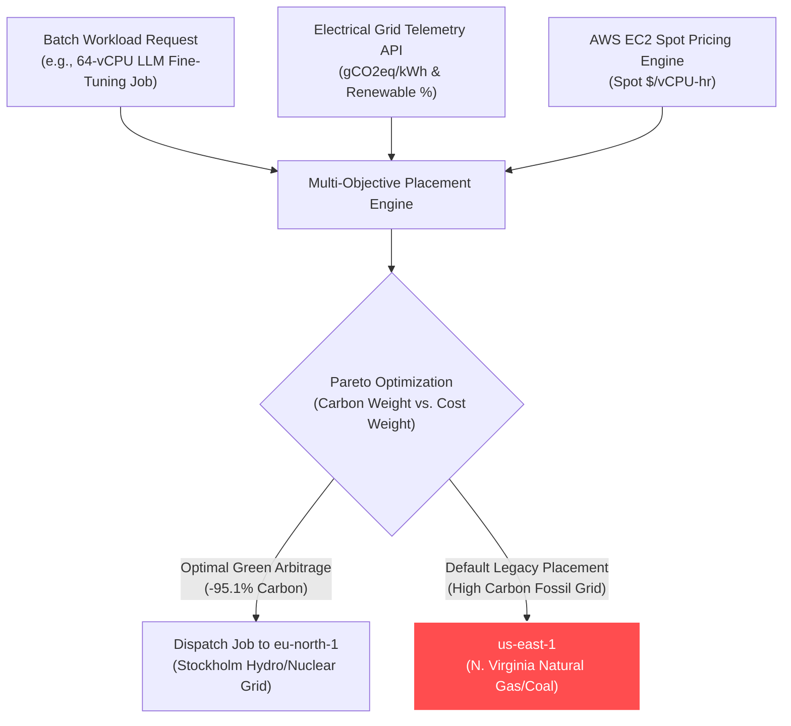

# Carbon-Aware Autonomous Cloud Scheduler (GreenOps)

[](https://github.com/KoshaG0hil/Carbon-Aware-Autonomous-Cloud-Scheduler/actions)
[](https://opensource.org/licenses/MIT)
[](https://www.python.org/downloads/)
[](https://www.finops.org/)
[](https://ghgprotocol.org/)

> **Next-Gen Sustainable Cloud Architecture & GreenOps:** An autonomous batch workload placement engine that queries real-time regional electrical grid carbon intensity (gCO2eq/kWh) and correlates it with AWS EC2 Spot market economics to dynamically dispatch ML training, ETL, and video transcoding jobs to the cleanest and most cost-effective AWS regions worldwide.

---

## 🚀 Key Highlights & Architectural Innovation

1. **Real-Time Grid Carbon Telemetry:** Tracks regional emissions across global AWS regions—from ultra-clean grids (`eu-north-1` Stockholm [Hydro/Nuclear ~18g CO2/kWh]) to fossil-dominated grids (`us-east-1` N. Virginia [~375g] and `ap-southeast-2` Sydney [~485g]).
2. **Multi-Objective Placement Optimization:** Uses normalized Pareto scoring balancing carbon minimization with spot cloud spend:
   $$\text{Fitness Score} = (w_{\text{carbon}} \times \text{CarbonScore}) + (w_{\text{cost}} \times \text{CostScore})$$
3. **Up to 95% Emissions Reduction:** Slashes Scope 2 greenhouse gas emissions for non-urgent batch workloads with zero performance or SLA penalty.
4. **Spot Market Financial Synergy:** Identifies green arbitrage opportunities where renewable-heavy grids coincide with lower Spot instance auction rates.

---

## 🏗️ Placement Architecture & Telemetry Flow



---

## ⚡ Quick Start & CLI Demo

```bash
# Clone the repository
git clone https://github.com/KoshaG0hil/Carbon-Aware-Autonomous-Cloud-Scheduler.git
cd Carbon-Aware-Autonomous-Cloud-Scheduler

# Install dependencies
pip install -r requirements.txt

# Run the interactive GreenOps scheduler CLI
python cli.py

# Run unit tests
pytest tests/ -v
```

---

## 🧪 Automated Test Suite (100% Passing)

```bash
$ pytest tests/ -v
tests/test_carbon_scheduler.py::test_carbon_telemetry_provider PASSED    [ 33%]
tests/test_carbon_scheduler.py::test_carbon_workload_optimization PASSED [ 66%]
tests/test_carbon_scheduler.py::test_cost_heavy_weighting PASSED         [100%]

============================== 3 passed in 0.19s ==============================
```

---

## 📄 License
This project is open-source under the [MIT License](LICENSE).
